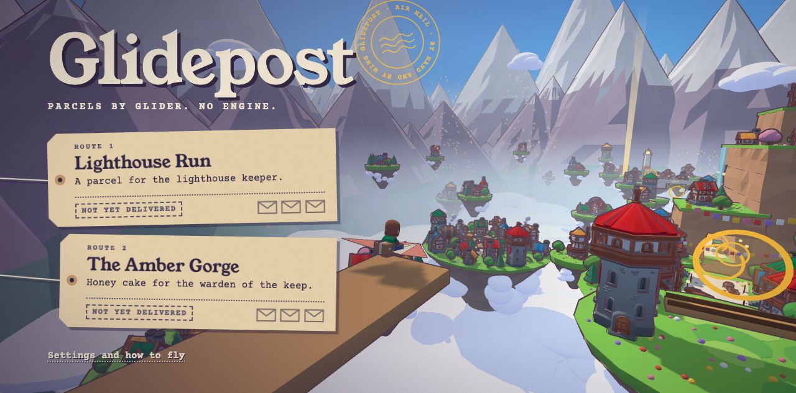

# Glidepost

A cosy 3D browser game about delivering parcels through a floating town on a glider.


You are the courier. Postmaster Orso hands you a parcel for Marigold, the lighthouse keeper, and
you launch from the post office with it strapped on behind you. The glider has no engine,
so every metre of height and every bit of speed has to come from somewhere. Getting there is easy.
Getting there fast is the game.

This is a playable prototype: two deliveries, each with a fast way and a safe way to fly it, a
timer, a best time, and a few things that are not on the map.



| | Route | Parcel | The fast way |
| --- | --- | --- | --- |
| 1 | **The valley** | For Marigold, the lighthouse keeper | Through the town: about 700 m, under 25 seconds. |
| 2 | **The Amber Gorge** | Honey cake for Warden Bram at Amberwatch Keep | Down the canyon: about 2 km, under 50 seconds. |

## Play

```sh
npm install
npm run dev
```

Then open the address Vite prints (usually http://localhost:5173). You start at the front desk
of the post office: pick a route off its parcel tag, hear Orso out, and launch.

| Action | Keyboard | Mouse |
| --- | --- | --- |
| Next line of dialogue, launch | Space | Click |
| Dive / pull up | W / S or ↑ / ↓ | Move down / up |
| Turn | A / D or ← / → | Move left / right |
| Boost | Space | Left button |
| Airbrake | Shift | Right button |
| Back to the deck, skip dialogue | R | |
| Stop the clock | Esc | |

Esc holds the flight at the sorting office: carry on, start again, pick another route, or open
the settings. The settings have the sound level, the mouse speed, a switch that swaps dive and
pull up, and a way to forget every time and letter. They are kept in the browser, as are your best
times.

Land on the gold pad at under 72 km/h. Under 50 km/h is a perfect landing.
Hitting anything, or sinking below the clouds, puts you back on the deck a second later.
Land it and whoever the parcel was for has a word for you about how it arrived.

## Three ways to gain energy

| Source | What it gives | The catch |
| --- | --- | --- |
| **Updrafts** (rising white motes) | Height, for free | Slow. Circling costs time. |
| **Boost rings** | An instant kick, bigger for each ring you chain | The line runs down a street, through a tunnel and past market stalls. |
| **Skimming** | Fly within a few metres of any surface to fill the boost meter | One twitch and you hit it. |

The safe route circles up over the market town's chimneys and takes most of a minute. The fast
route follows the ring line: between the gate towers, down Chimney Lane, through the tunnel under
the waterfall rock, along the terrace market, under the viaduct and between the windmills. It can
be done in under 25 seconds.

In the gorge the ring line threads the Needles, drops into a canyon with a river village on its
floor, goes under two bridges and an aqueduct, down the high street of a town and under a rock
arch to the keep. The safe way climbs the warm air off the baker's chimney in the Needles and
stays high over the rim.

## Off the route

Three letters went astray on each route, years ago, and they are still out there. Fly through one
to pick it up. They are kept between flights, and whoever gets the parcel has something to say if
you turn up with all three. Orso drops a hint about where to start looking.

Some of them are down a **wind stream**: a river of pale motes in the air that carries the glider
along with it. One runs out of a cave nobody talks about, and another through a rock that the old
couriers called hollow.

Pass close to a church steeple and the bell rings. And look up now and then.

## How it is built

TypeScript, [Three.js](https://threejs.org) and [Vite](https://vite.dev). There is no physics
engine. Rock, trees, clouds and the mountains round the valley are built from boxes, cones and
spheres; the buildings, market props and the courier are [imported models](#credits). Everything
is drawn like a storybook, with flat shading and ink outlines, and all sound is synthesised.
Everything on screen that is not the world is post: parcel tags, a postcard, telegram tape,
rubber stamps and a receipt, in plain HTML and CSS.

| File | What it does |
| --- | --- |
| `src/config.ts` | Every tuning value. Start here to change how the game feels. |
| `src/flight.ts` | The flight model: speed, drag, stall, boost. |
| `src/world.ts` | The parts a level is built from, and the distance queries for crashing and skimming. |
| `src/levels.ts`, `src/levels/` | The routes: what a level is, and the layout of each one. |
| `src/models.json` | The size and collision boxes of each model, written by `scripts/measure-models.mjs`. |
| `src/game.ts` | The rules of a delivery: launch, rings, landing, crashing. |
| `src/scene.ts` | Everything you see. |
| `src/input.ts` | Keyboard and mouse. |
| `src/audio.ts` | Wind and sound effects. |
| `src/hud.ts` | The numbers and messages on screen. |
| `src/shell.ts` | The front desk, the pause and settings forms, and the receipt. |
| `src/save.ts` | What the browser keeps: settings, best times and found letters. |
| `src/story.ts` | Who speaks, and what they say before and after the flight. |
| `src/dialogue.ts` | The dialogue box: portrait, name and typed-out text. |
| `src/main.ts` | The frame loop and chase camera. |

The flight model and the rules do not touch the renderer, so the tests fly the fast way and the safe way
of every level with an autopilot to check that they stay possible after a tuning change.

```sh
npm test         # run the tests
npm run build    # type-check and build to dist/
```

A model collides as a stack of five boxes that follows its outline, so you can fly past a roof
ridge without hitting the air next to it. After adding or changing a file in `public/models`, run
`node scripts/measure-models.mjs` to measure it again.

## Design

[docs/DESIGN.md](docs/DESIGN.md) has the full design: the pillars, the flight model, the prototype
scope, and what comes later (ghost replays, parcel types, more islands, a daily route).

## Credits

The buildings and props are from the [KayKit Medieval Hexagon Pack](https://kaylousberg.itch.io/kaykit-medieval-hexagon)
and the courier and the portraits are from the [KayKit Adventurers pack](https://kaylousberg.itch.io/kaykit-adventurers),
both by [Kay Lousberg](https://www.kaylousberg.com) and released under
[CC0](https://creativecommons.org/publicdomain/zero/1.0/).

The typefaces are [Young Serif](https://github.com/noirblancrouge/YoungSerif) and
[Courier Prime](https://github.com/quoteunquoteapps/CourierPrime), both under the
[SIL Open Font License 1.1](https://openfontlicense.org). Their licences are in `public/fonts`.
