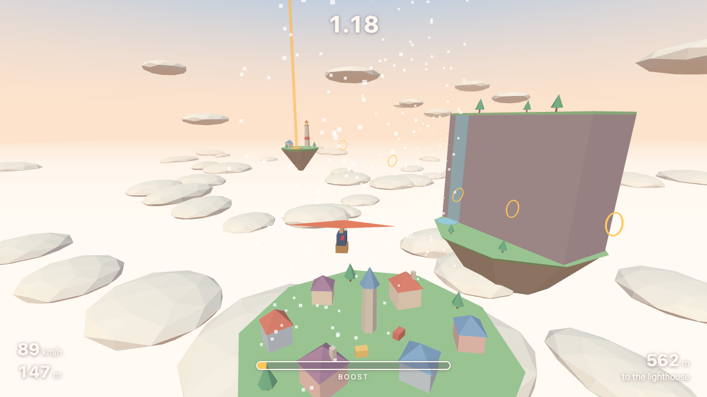

# Glidepost

A cosy 3D browser game about delivering parcels between floating islands on a glider.



You launch from the post office with a parcel for the lighthouse keeper. The glider has no engine,
so every metre of height and every bit of speed has to come from somewhere. Getting there is easy.
Getting there fast is the game.

This is a playable prototype: one delivery, two routes, a timer and a best time.

## Play

```sh
npm install
npm run dev
```

Then open the address Vite prints (usually http://localhost:5173).

| Action | Keyboard | Mouse |
| --- | --- | --- |
| Launch | Space | Click |
| Dive / pull up | W / S or ↑ / ↓ | Move down / up |
| Turn | A / D or ← / → | Move left / right |
| Boost | Space | Left button |
| Airbrake | Shift | Right button |
| Back to the deck | R | |

Land on the gold pad next to the lighthouse at under 72 km/h. Under 50 km/h is a perfect landing.
Hitting anything, or sinking into the clouds, puts you back on the deck a second later.

## Three ways to gain energy

| Source | What it gives | The catch |
| --- | --- | --- |
| **Updrafts** (rising white motes) | Height, for free | Slow. Circling costs time. |
| **Boost rings** | An instant kick, bigger for each ring you chain | The line runs right past a cliff. |
| **Skimming** | Fly within a few metres of any surface to fill the boost meter | One twitch and you hit it. |

The safe route circles up over the market town's chimneys and takes about 45 seconds. The fast
route dives along the waterfall cliff through the ring line and can be done in under 20.

## How it is built

TypeScript, [Three.js](https://threejs.org) and [Vite](https://vite.dev). There is no physics
engine and there are no asset files: the level is built from boxes, cones and spheres, and all
sound is synthesised.

| File | What it does |
| --- | --- |
| `src/config.ts` | Every tuning value. Start here to change how the game feels. |
| `src/flight.ts` | The flight model: speed, drag, stall, boost. |
| `src/world.ts` | The level layout, and the distance queries for crashing and skimming. |
| `src/game.ts` | The rules of a delivery: launch, rings, landing, crashing. |
| `src/scene.ts` | Everything you see. |
| `src/input.ts` | Keyboard and mouse. |
| `src/audio.ts` | Wind and sound effects. |
| `src/hud.ts` | The numbers and messages on screen. |
| `src/main.ts` | The frame loop and chase camera. |

The flight model and the rules do not touch the renderer, so the tests fly both routes with an
autopilot to check that they stay possible after a tuning change.

```sh
npm test         # run the tests
npm run build    # type-check and build to dist/
```

## Design

[docs/DESIGN.md](docs/DESIGN.md) has the full design: the pillars, the flight model, the prototype
scope, and what comes later (ghost replays, parcel types, more islands, a daily route).
